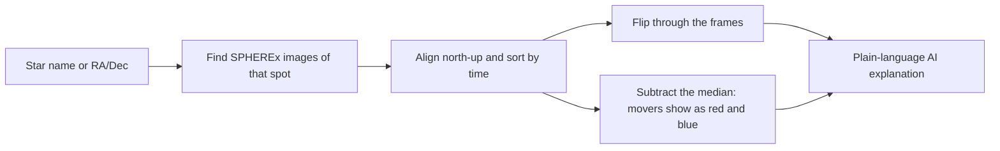

<!-- Before submitting: search this file for "[" and fill in or delete every bracket. -->


<h1 align="center">Space Finder 3000</h1>

<p align="center">
  <b>Watch the sky <i>move</i>.</b><br>
  Flip through real NASA SPHEREx images, see what changed, and get a plain-English explanation of what you're looking at.
</p>

<p align="center">
  <a href="https://saltyourhash.github.io/hackathonprojectexample/"><b>▶ Live demo</b></a> ·
  <a href="[video link]">30-second video</a> ·
  <a href="[slides link]">Slides</a>
</p>

<p align="center">
  
  
  
  
</p>

> **A billion objects. One telescope. The whole sky, every six months.**
> Somewhere in those images, stars, comets and maybe new worlds are moving. [Project Name] helps anyone find them.

**1B+** objects imaged · **102** infrared bands · **6 months** per full-sky map · **4** ways to view movers · **0** astronomy degrees required

<p align="center">
  
</p>
<!-- Record a 5-10 second GIF: type a name, press play, switch to "Frame − median". Save it as demo.gif next to this file. -->

**Jump to:** [Why](#why-this-exists) · [What you can do](#what-you-can-do) · [Try it](#try-it-in-3-steps) · [How it works](#how-it-works) · [What's different](#whats-different) · [Limits](#honest-limits) · [Credits](#data-and-credits) · [AI usage](#ai-usage) · [Team](#team)

---

## Why this exists

SPHEREx is mapping the entire sky in 102 bands of near-infrared light and repeating the map every six months. Anything that moves or changes between maps (comets, asteroids, nearby stars, brown dwarfs, and possibly new planets) gives itself away by shifting position.

But there is far too much sky for one person to scan, and the data is hard to reach if you aren't a researcher. We built [Project Name] so a curious student can try it in a minute.

## What you can do

| You want to… | [Project Name] gives you |
|---|---|
| Find a star without knowing its coordinates | **Search by name** (AI-assisted), or enter RA/Dec |
| See how a patch of sky changes | A **time-lapse** of real SPHEREx frames, aligned north-up and played in time order, 1 to 8 frames per second |
| Spot only what moved | **Frame − median** view: the unchanging sky cancels out and movers show as **red and blue** |
| Compare moments | Frame − previous, single-frame and stacked views |
| Understand what you're seeing | A **plain-language AI explanation** |
| Get started fast | **Presets** for Barnard's Star, Epsilon Indi B, WISE 0855, RW Aurigae and R Draconis |
| See the sky in color | [Describe what the colors show] |
| Look closer | Field of view, detector selection, invert and a target ring |

## Try it in 3 steps

1. **Target.** Type a star's name or sky coordinates, or pick a preset.
2. **Flip.** Press play to step through the images in time order.
3. **Discover.** Switch to the median view so movers pop out in [SOME COLORS], then read the explanation.

**Good first targets**

| Preset | What it is | Why try it |
|---|---|---|
| Barnard's Star | A nearby red dwarf | Holds the record for the largest known proper motion, about 10 arcseconds a year |
| Epsilon Indi B | A nearby brown dwarf | A "hidden neighbor" that moves noticeably |
| WISE 0855 | A very cold brown dwarf | Faint and hard to see, so a real challenge |
| RW Aurigae, R Draconis | Variable stars | They don't move, but their brightness changes |

## See it in action

<table>
  <tr>
    <td><br><sub><i>[Caption: flipping through time]</i></sub></td>
    <td><br><sub><i>[Caption: the mover pops out as [SOME COLORS]]</i></sub></td>
    <td><br><sub><i>[Caption: the plain-language explanation]</i></sub></td>
  </tr>
</table>

## How it works
## NOTE: Swap this with our UML Diagram


<!-- Confirm this flow with your developer and edit the boxes to match what the code really does. -->

**Images:** NASA SPHEREx data from the NASA/IPAC Infrared Science Archive (IRSA) and AWS Open Data.
**Stack:** [languages, libraries, hosting, AI model]

## What's different

- **Movers light up.** We don't just play frames. We subtract the background so motion shows as [SOME COLORS].
- **Anyone can find a star.** Search by name, not only coordinates.
- **It explains itself.** Plain-language explanations make the data approachable for students, teachers and curious people.

## Honest limits

- Very slow movers can shift by less than one pixel between images, so they can look like they're standing still.
- SPHEREx sees the sky through a variable filter, so a star's brightness differs from image to image. A brightness change only means something when comparing the same band.
- This tool helps people look for movers. It does not claim to have found Planet X or any new object.
- AI explanations can be wrong or oversimplified.
- [Add anything specific to your prototype, such as slow loading, limited targets or demo data.]

## Data and credits

Images: NASA SPHEREx via the NASA/IPAC Infrared Science Archive (IRSA) and AWS Open Data. SPHEREx is a joint project of the Jet Propulsion Laboratory and the California Institute of Technology, funded by NASA. Name resolution: [service name, if used].

## AI usage

- **In the product:** AI is used for name searching, plain-language explanations, [ETC]. Model: [AI MODEL/PROVIDER].
- **In development:** [Describe any AI tools used to write code, copy or documentation.]
- AI-generated explanations are a starting point, not a verified scientific result.

## Team

| Name | Role |
|---|---|
| Abigail Diaz | Head UI/UX/Graphic Designer, Asst. Software/Hardware Developer, Asst. Data Scientist/AI Specialist |
| Addison Drobny  | Head Software/Hardware Developer |
| Azure | Co Subject Matter Specialist, Co Storyteller/Communicator |
| Drake Cheever | Co Subject Matter Specialist, Co Storyteller/Communicator |
| EJ Mabanto | Head Data Scientist/AI Specialist, Asst. Software / Hardware Developer |
| Elliot | Co Subject Matter Expert |

## Run it locally

```bash
[commands to install and run]
```

## Acknowledgments and license

Thanks to NASA, the SPHEREx team, IPAC/IRSA, and the NASA Space Apps Challenge organizers and mentors.

License: [e.g., MIT]
