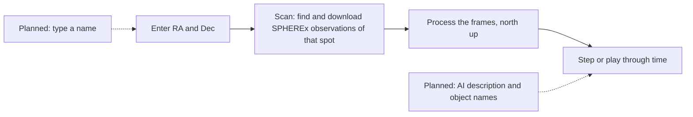

<!-- Before submitting: search this file for "[" and fill in or delete every bracket. -->


<h1 align="center">Space Finder 3000</h1>

<p align="center">
  <b>Watch the sky <i>move</i>.</b><br>
  Pick any spot in the sky and flip through real NASA SPHEREx images of it over time.
</p>

<p align="center">
  <a href="https://www.spacefinder3000.us/"><b>▶ Live demo</b></a> ·
  <a href="[video link]">30-second video</a> ·
  <a href="[slides link]">Slides</a>
</p>

<p align="center">
  
  
  
  
</p>

> **A billion objects. One telescope. The whole sky, every six months.**
> Somewhere in those images, stars, comets and maybe new worlds are moving. Space Finder 3000 helps anyone go and look.

**1B+** objects imaged · **102** infrared bands · **6 months** per full-sky map · **100%** real observations

<p align="center">
  
</p>
<!-- Record a 5-10 second GIF: enter coordinates, scan, press play. Save it as demo.gif next to this file. -->

**Jump to:** [Why](#why-this-exists) · [What you can do](#what-you-can-do) · [Try it](#try-it-in-3-steps) · [How it works](#how-it-works) · [What's different](#whats-different) · [Limits](#honest-limits) · [What's next](#whats-next) · [Credits](#data-and-credits) · [AI usage](#ai-usage) · [Team](#team)

---

## Why this exists

SPHEREx is mapping the entire sky in 102 bands of near-infrared light and repeating the map every six months. Anything that moves or changes between maps (comets, asteroids, nearby stars, brown dwarfs, and possibly new planets) gives itself away by shifting position.

But there is far too much sky for one person to scan, and the data is hard to reach if you aren't a researcher. We built Space Finder 3000 so a curious student can pick a spot and start looking in a minute.

## What you can do

| You want to… | Space Finder 3000 gives you |
|---|---|
| Look at a specific spot in the sky | Enter its **right ascension and declination** in degrees |
| See how that spot changes | The SPHEREx observations of it, **in time order**, to step through or play |
| Move around quickly | A frame counter and timeline, plus keyboard shortcuts |
| Make faint things easier to see | An image stretch that changes visibility, never the underlying measurements |
| Read the image like a sky map | **North is up and east is to the left** |
| Know what you're looking at | Plain notes in the app: every frame is a real observation, and the sequence is separate observations, not video |
| Come back to a spot | A list of saved coordinate targets [confirm how targets get saved] |
| Know where you are in the sky | A survey grid / area guide [describe what it shows] |

**Keyboard shortcuts:** arrow keys step through frames · Shift + arrows jump five frames · Space plays or pauses

## Try it in 3 steps

1. **Aim.** Enter a right ascension and declination in degrees.
2. **Scan.** The tool downloads and processes the SPHEREx observations of that spot.
3. **Explore.** Step through the frames or press play, and watch for anything that shifts.

**Good first targets**

| Target | What it is | RA, Dec (degrees) | Why try it |
|---|---|---|---|
| Barnard's Star | A nearby red dwarf | 269.4521, +4.6933 | Holds the record for the largest known proper motion, about 10 arcseconds a year |
| Epsilon Indi B | A nearby brown dwarf | 331.0438, −56.7828 | A "hidden neighbor" that moves noticeably |
| R Draconis | A variable star | 248.1675, +66.7550 | It doesn't move, but its brightness changes |

<!-- Verify these positions work in the live tool before submitting. They are J2000 positions, and fast movers have drifted since, so a star may sit off-center. -->

## See it in action

<table>
  <tr>
    <td><br><sub><i>[Caption: entering a spot in the sky]</i></sub></td>
    <td><br><sub><i>[Caption: stepping through frames in time order]</i></sub></td>
    <td><br><sub><i>[Caption: a star that shifted between frames]</i></sub></td>
  </tr>
</table>

## How it works

<!-- NOTE: swap the mermaid diagram below for your UML diagram when it's ready. -->


<!-- Confirm this flow with your developer and edit the boxes to match what the code really does. -->

**Images:** NASA SPHEREx data from the NASA/IPAC Infrared Science Archive (IRSA) and AWS Open Data.
**Stack:** [languages, libraries, hosting]

## What's different

- **Honest about the data.** The app tells you each frame is a real observation, that the sequence is separate observations and not video, and that the image stretch never changes the measurements.
- **Built for beginners.** A simple Aim, Scan, Explore flow and plain labels instead of a wall of controls.
- **Mission-control feel.** A frame counter, timeline and status readouts that make exploring the sky feel like an expedition.

## Honest limits

- The sequence is separate observations taken at different times, not continuous video, so expect gaps between frames.
- For now you search by coordinates only. Name search is planned (see [What's next](#whats-next)).
- Very slow movers can shift by less than one pixel between images, so they can look like they're standing still.
- SPHEREx sees the sky through a variable filter, so a star's brightness differs from image to image. A brightness change only means something when comparing the same band.
- The tool shows you the images. Spotting what moved is still up to you, and we don't claim to have found Planet X or any new object.
- The IRSA IPA occasionally bugs out/crashes and does not display data. This error is hard to work around, and we were unable to fix it at the moment.
- [Add anything specific to your prototype, such as slow scans or limited coverage.]

## What's next

The prototype gets real SPHEREx frames in front of anyone. Next we want to make the sky easier to find and easier to understand, using a large language model (LLM):

- **Search by name.** Type "Barnard's Star" and the tool works out the coordinates, so nobody needs to know RA and Dec.
- **Plain-language descriptions.** The LLM writes a short, friendly description of the patch of sky you're viewing and what to look for.
- **Name the objects in view.** The LLM identifies the stars and other objects in the field and explains what they are.
- **Keep the AI honest.** Names and facts would come from a real catalog (such as SIMBAD), with the model only putting them into plain language, so it never has to guess.
- **Multiple Viewpoints.** Ability to open multiple windows, each letting you view multiple stars side by side and display their movements.
- **AI Assistance.** A chat bot that can give you quick directions, as many locations of any stars you want, and more.
- [Other ideas, such as highlighting movers automatically or shareable links to a spot.]

## Data and credits

Images: NASA SPHEREx via the NASA/IPAC Infrared Science Archive (IRSA) and AWS Open Data. SPHEREx is a joint project of the Jet Propulsion Laboratory and the California Institute of Technology, funded by NASA.

## AI usage

- **In the product:** none yet. The current prototype shows real SPHEREx data with no AI-generated content. LLM features are planned (see [What's next](#whats-next)).
- **In development:** Used AI to proofread and assist with debugging code.
- When AI descriptions are added (in the future), we'll label them as AI-generated, because they are a starting point and not a verified scientific result.

## Team

| Name | Role |
|---|---|
| Abigail Diaz | Head UI/UX/Graphic Designer, Asst. Software/Hardware Developer, Asst. Data Scientist/AI Specialist |
| Addison Drobny | Head Software/Hardware Developer |
| Azure | Co Subject Matter Specialist, Co Storyteller/Communicator |
| Drake Cheever | Co Subject Matter Specialist, Co Storyteller/Communicator |
| EJ Mabanto | Head Data Scientist/AI Specialist, Asst. Software/Hardware Developer |
| Elliot | Co Subject Matter Expert |

---

## Run it locally

### Requirements
- Python 3
- macOS or Linux
- Internet connection to retrieve SPHEREx observations

### 1. Clone the repository

```bash
git clone https://github.com/aedrobny/NH2T-Planet-X-and-SPHEREx.git
cd NH2T-Planet-X-and-SPHEREx
```

### 2. Create and activate a virtual environment

```bash
python3 -m venv .venv
source .venv/bin/activate
```

### 3. Install the required Python packages
```bash
python -m pip install --upgrade pip
python -m pip install astroquery astropy numpy requests imageio matplotlib pillow
```

### 4. Start the local server
```bash
python spherex_server.py
```
Keep the terminal running while using the application.

### 5. Open the website

Visit: http://127.0.0.1:8000/index.html

### 6. Start exploring
1. Enter right ascension (RA) and declination (Dec) in decimal degrees.

2. Click INITIATE SCAN.

3. The server retrieves available SPHEREx observations and processes them into PNG frames.

4. Explore the observations using the playback controls.

## Acknowledgments and license

Thanks to NASA, the SPHEREx team, IPAC/IRSA, and the NASA Space Apps Challenge organizers and mentors.

License: Space Finder 3000
